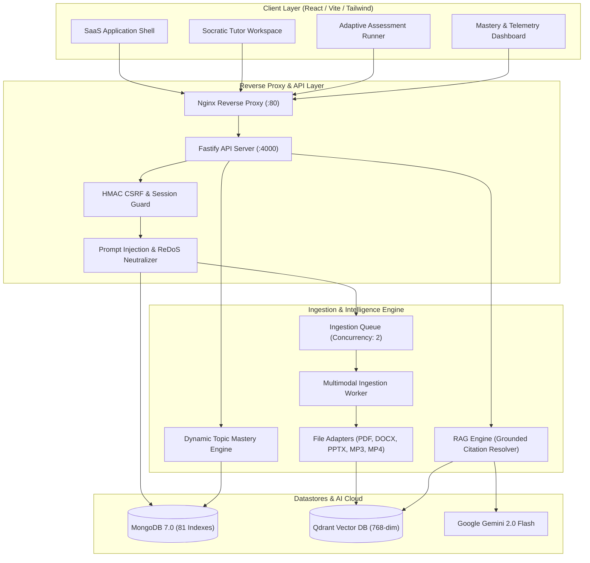

# OmniTutor AI

> **Personalized Tutoring & Adaptive Multimodal Learning Platform**  
> Cognitive Socratic scaffolding, grounded citation verification, adaptive difficulty calibration, and multimodal knowledge retrieval.

---

## 📌 Architecture & System Overview

OmniTutor AI is an enterprise-grade AI tutoring platform built as a strict TypeScript monorepo using **npm workspaces**:

- **Frontend (`apps/web`)**: React 18, Vite, TypeScript, Tailwind CSS, React Router v6, Zustand, TanStack React Query, React Hook Form, Zod, Lucide icons.
- **Backend (`apps/api`)**: Node.js 20, Fastify 5, TypeScript, Mongoose (MongoDB 7.0), Pino structured logging, centralized error handling, and request ID tracking.
- **AI Service Abstraction**: Google Gemini 2.0 Flash (`@google/genai`) with injectable interfaces and graceful standalone degradation.
- **Vector Storage**: Qdrant vector database (`@qdrant/js-client-rest`) with payload filtering and semantic cosine similarity search.
- **Shared Package (`packages/shared`)**: Shared domain types, Zod validation schemas, and standard API envelope contracts.
- **Production Orchestration (`docker-compose.yml`)**: Production-ready MongoDB 7.0 (81 indexes), Qdrant v1.13.2, Fastify API, persistent file storage volume, and Nginx reverse proxy.



---

## 🚀 Quick Demo Setup (Under 2 Minutes)

### 1. Prerequisites
- **Node.js**: `v20.0.0` or higher
- **npm**: `v10.0.0` or higher
- **Docker Desktop** (for local MongoDB & Qdrant containers)

### 2. Install & Configure
```powershell
# Install monorepo dependencies
npm install

# Copy environment configuration files
Copy-Item .env.example .env
Copy-Item apps/api/.env.example apps/api/.env
Copy-Item apps/web/.env.example apps/web/.env
```

### 3. Launch Databases & Seed Demo Fixtures
```powershell
# 1. Start MongoDB and Qdrant containers
docker compose up -d mongodb qdrant

# 2. Synchronize database indexes (81 indexes across 15 collections)
npm run db:init

# 3. Seed synthetic demo curriculum fixtures & verified student account
npm run seed:demo
```

### 4. Start Development Stack
```powershell
npm run dev
```

### 5. Access the Platform
- **Student Web Application**: [http://localhost:5173](http://localhost:5173) (or [http://localhost:80](http://localhost:80) under Docker)
- **Fastify API Server**: [http://localhost:4000/api/v1](http://localhost:4000/api/v1)
- **Pre-Seeded Demo Credentials**:
  - **Email**: `demo.student@omnitutor.ai`
  - **Password**: `DemoStudent123!`
  - **Pre-Indexed Course**: `CS301: Distributed Systems & Cloud Infrastructure`

---

## 🏆 Implemented Modules & Capabilities

| Module | Title | Key Implemented Features |
|---|---|---|
| **Module 1** | System Foundation & Architecture | Fastify 5 API, Mongoose connection lifecycle, health/ready probes, injectable AI & Qdrant providers, uniform envelope. |
| **Module 2** | Design System & Shell | React 18, Tailwind glassmorphic dark theme, responsive layout, modal dialogs, TanStack Query, Zustand state. |
| **Module 3** | Authentication & Security | Argon2id hashing, HttpOnly session cookies, double-submit HMAC CSRF, account enumeration defense, email verification. |
| **Module 4** | Courses & File Uploads | Course creation, management, streaming multipart uploads, magic-byte inspection, scanned PDF detection, private storage. |
| **Module 5** | Multimodal Ingestion Pipeline | Adapters for PDF, DOCX, PPTX, MP3, MP4; async job queue with status polling, chunking, and Qdrant indexing. |
| **Module 6** | Grounded Tutoring & Citations | Vector similarity search, strict course isolation filters, interactive citations `[cite:N]`, provenance resolution. |
| **Module 7** | Socratic Tutoring Experience | Socratic vs Explanatory modes, progressive hint generation, prompt injection sanitizer, streaming message timeline. |
| **Module 8** | Adaptive Assessments | MCQ, multi-select, and short-answer generation; answer key protection; 15s submission deduplication; dynamic mastery. |
| **Module 9** | Analytics & Study Plans | Event-driven study time tracking, streak calculation, personalized recommendations, milestone-based study plans. |
| **Module 10** | Multimodal Viewer & Study Tools | In-app material viewer, summary/formula card generation, flashcard creation, audio transcripts, concept notes. |
| **Module 11** | Security Hardening & Reliability | Cross-user data isolation, ReDoS defense, transient backoff, startup reconciliation, sanitized probes, 104 tests. |
| **Module 12** | Deployment & Hackathon Demo | Multi-stage Docker builds, Nginx reverse proxy, durable volumes, safe demo seeding, comprehensive documentation. |
| **Module 13** | Advanced Learning Features & Polish | Knowledge gap detection, Socratic multi-step scaffolding, multilingual tutoring with citation preservation, forgetting-curve revision scheduling with heuristics disclaimers, learning objective mapping & coverage, voice speech input & TTS, privacy-preserving teacher analytics, and reproducible AI evaluation benchmark dashboard. |

---

## 🔒 Security Hardening Matrix

| Security Domain | Implemented Control | Verified By |
|---|---|---|
| **Multi-Tenancy** | Strict course ownership verification and Qdrant metadata filters (`courseId` match). | Negative tests in `security-reliability.test.ts` |
| **Authentication** | Argon2id password hashing and cryptographically secure session cookies. | Session tests in `auth.test.ts` |
| **CSRF Defense** | HMAC-signed double-submit cookie validation with timing-safe comparison. | CSRF tests in `security-reliability.test.ts` |
| **Answer Leakage** | Strips `correctAnswer`, `rubric`, and `explanation` before quiz submission. | Assessment tests in `assessment.test.ts` |
| **Prompt Injection** | Strips adversarial overrides (`ignore instructions`, `DAN`, delimiter injection). | Normalization tests in `rag.test.ts` |
| **ReDoS Defense** | Max-length bounds (100 chars) and regex metacharacter escaping (`safeSearchRegex`). | ReDoS tests in `security-reliability.test.ts` |
| **Deduplication** | Idempotent 15-second deduplication on quiz submission and active ingestion jobs. | Dedup tests in `security-reliability.test.ts` |
| **File Security** | Magic-byte signature verification and zip-bomb / path-traversal prevention. | Upload tests in `upload-ingestion.test.ts` |
| **Probe Disclosure** | Health/readiness probes disclose only operational state, masking credentials. | Health tests in `health.test.ts` |
| **Student Privacy** | Course-level teacher analytics aggregate cohort performance while strictly isolating private student chat logs. | Analytics tests in `module13-advanced-learning.test.ts` |

---

## 🧪 Testing & Verification Suite

OmniTutor AI maintains **100% passing automated test coverage** across 111 tests (13 API test suites, 95 API tests + 16 Web tests):

```powershell
# Run all monorepo test suites (API + Web)
npm test

# Run API test suites only (13 test suites, 95 tests)
npm run test:api

# Run Web frontend test suites only (3 test suites, 16 tests)
npm run test:web

# Run TypeScript type check across all workspaces
npm run typecheck

# Run monorepo code linting
npm run lint

# Build all packages and applications for production
npm run build
```

---

## 🐳 Docker Deployment

To launch the full production stack:
```powershell
# Build and start all 4 production containers
docker compose up --build -d

# View running container status
docker compose ps

# View application logs
docker compose logs -f api
```

The container stack comprises:
- `omnitutor-mongodb`: MongoDB 7.0 database backed by `mongo_data` volume.
- `omnitutor-qdrant`: Qdrant v1.13.2 vector engine backed by `qdrant_data` volume.
- `omnitutor-api`: Fastify backend API with persistent `api_uploads` volume.
- `omnitutor-web`: Nginx reverse proxy serving optimized React SPA on port 80.

---

## 📚 Technical Documentation

- **[System Architecture](file:///docs/ARCHITECTURE.md)**: Micro-architecture, domain modules, and data flow.
- **[Development & Operations Guide](file:///docs/DEVELOPMENT.md)**: Local development setup, credentials, and troubleshooting.
- **[Security Audit & Reliability Review](file:///docs/SECURITY_AUDIT.md)**: Threat modeling, defense-in-depth, and accepted risk assessment.
- **[Hackathon Presentation & Demo Guide](file:///docs/DEMO_GUIDE.md)**: 3-5 minute live demonstration talk track and fallback plans.
- **[Backup & Disaster Recovery Guide](file:///docs/BACKUP_AND_RECOVERY.md)**: MongoDB dumps, Qdrant snapshots, and volume backups.
- **[Ingestion Troubleshooting Guide](file:///docs/INGESTION_TROUBLESHOOTING.md)**: Multimodal ingestion diagnostics and recovery.
