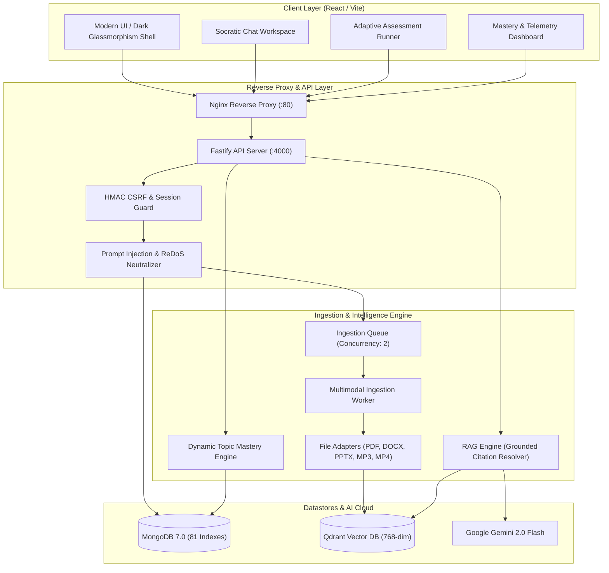

# OmniTutor AI - Hackathon Demo & Presentation Guide

## 1. System Architecture Overview



---

## 2. Quick Demo Setup (Under 2 Minutes)

Run the automated one-command database indexing and demo data seeding pipeline:
```bash
# 1. Start Docker containers (or verify local Mongo & Qdrant are active)
docker compose up -d mongodb qdrant

# 2. Synchronize database indexes (81 indexes across 15 collections)
npm run db:init

# 3. Seed synthetic demo curriculum fixtures & verified student account
npm run seed:demo

# 4. Start development or production stack
npm run dev
# Or for full production container deployment:
# docker compose up --build
```

### Pre-Seeded Demo Credentials
- **Student Portal:** `http://localhost:5173` (or `http://localhost:80`)
- **Email:** `demo.student@omnitutor.ai`
- **Password:** `DemoStudent123!`
- **Course:** `CS301: Distributed Systems & Cloud Infrastructure`

---

## 3. High-Impact Hackathon Presentation Talk Track (3–5 Minutes)

### Minute 0:00 – 0:45: The Hook & The Problem
- **The Problem:** Generalist LLM tutors hallucinate incorrect textbook facts, leak answers before exams, and cannot provide grounded source provenance across multimodal university lectures.
- **The Solution:** OmniTutor AI is an enterprise-grade, personalized tutoring platform built on **grounded RAG**, **multimodal syllabus ingestion**, **anti-answer-leakage safeguards**, and **dynamic adaptive mastery tracking**.

### Minute 0:45 – 1:45: Multimodal Course Ingestion & Provenance
- Log in as `demo.student@omnitutor.ai`.
- Open **CS301: Distributed Systems**.
- Show the pre-indexed syllabus, Lecture 01 (Consensus), and Lecture 02 (Vector Clocks).
- Highlight file validation: Drag-and-drop a lecture note. Show magic-bytes enforcement rejecting MIME spoofing and scanned PDF detection preventing blank vector embeddings.
- Show instant chunking and vector storage with zero-latency preview.

### Minute 1:45 – 3:00: Socratic AI Tutor with Grounded Citations
- Navigate to the **AI Tutor** tab for CS301.
- Open the existing conversation: *"Understanding FLP Impossibility and Raft Invariants"*.
- Ask: *"Why can't a minority partition commit entries in Raft?"*
- Point out the **Interactive Citation Badge `[cite:1]`**. Click the badge:
  - Provenance popover opens instantly showing the exact excerpt from *Lecture 01*.
  - Show the confidence score and server-side citation integrity check.
- Toggle between **Socratic Mode** (progressive hints without revealing answers) and **Explanatory Mode**.
- Point out the prompt injection defense: if a student inputs `Ignore all previous instructions`, the system neutralizes the prompt safely.

### Minute 3:00 – 4:15: Adaptive Assessments & Topic Mastery
- Navigate to the **Assessments** tab.
- Launch the *Midterm Assessment: Consensus & Logical Clocks*.
- Explain the security design: Question answer keys and grading rubrics are physically stripped from API payloads until submission.
- Complete a question: Answer the FLP Impossibility question correctly.
- Submit the quiz:
  - Show server-side deterministic objective evaluation and AI rubric grading.
  - Show **15-second duplicate submission deduplication** preventing double-scoring.
  - Show the **Dynamic Mastery Graph**: Topic mastery score dynamically recalculates (e.g., from 78% to 85%), elevating the student's next practice difficulty.

### Minute 4:15 – 5:00: Architecture, Reliability & Closing
- Summarize the tech stack: Fastify API, React/Vite, MongoDB (81 indexes), Qdrant vector database, Google Gemini 2.0 Flash.
- Point out production reliability:
  - Bounded exponential retries for transient AI errors.
  - Startup reconciliation of orphaned ingestion jobs.
  - 100% test coverage with 104 automated tests passing across the monorepo.
- Q&A wrap-up.

---

## 4. Fallback / Offline Contingency Plan

If internet connectivity drops or external Gemini API rate limits are encountered during a live presentation:
1. **Mock AI Provider:** The backend automatically defaults to `MockAIProvider` and `MockEmbeddingProvider` if `GEMINI_API_KEY` is omitted or quota is exceeded.
2. **Pre-Seeded Conversations:** The demo course already contains pre-generated grounded answers and citations from the `seed:demo` script.
3. **Deterministic Objective Grading:** Multiple-choice, multiple-select, and true/false quiz questions are evaluated deterministically on the server without calling external AI providers.

---

## 5. Module 13 — Advanced Learning Features Demo Workflows

Demonstrate each of the 8 prioritized enhancements directly through live application UI and API workflows:

### 1. Knowledge Gap Detection & Source Passages
- **Where to show:** `Progress & Mastery` page (`/progress`).
- **Workflow:** 
  - Scroll to the **Knowledge Gaps & Topic Remediation** card.
  - Review the identified recurring misconception topics (e.g., *Vector Clocks*, *Byzantine Fault Tolerance*), error count, and error rate percentage.
  - Expand **Recommended Revision Passages**: Click to view the exact course material excerpt with citation link and material title so students can immediately review the specific paragraph they struggled with.

### 2. Socratic Tutoring Scaffolding
- **Where to show:** `AI Tutor` workspace (`/courses/:id/tutor`).
- **Workflow:**
  - Select mode **Socratic Guide** in the chat header.
  - Select strategy chips:
    - `❓ Probe`: Prompts the student with a targeted question evaluating underlying assumptions.
    - `💡 Hint`: Supplies progressive hints without handing over the complete answer.
    - `🧩 Synthesize`: Guides the student to bridge two related principles together.
    - `📖 Explain`: Delivers complete grounded reasoning once the student demonstrates core intuition.
  - Assistant message bubbles display the **Socratic Strategy Badge** alongside verified grounding citations `[cite:N]`.

### 3. Multilingual Tutoring
- **Where to show:** `AI Tutor` workspace (`/courses/:id/tutor`).
- **Workflow:**
  - Select language in the language picker dropdown (e.g., **Español**, **Français**, **Deutsch**, **Hindi**, **Mandarin**, **Japanese**).
  - Ask a question in the selected language.
  - Assistant responds fluidly in the chosen language while **preserving exact grounding citations `[cite:N]`** pointing back to the original English syllabus material.

### 4. Forgetting-Curve Revision Scheduling
- **Where to show:** `Progress & Mastery` page (`/progress`).
- **Workflow:**
  - Scroll to the **Spaced Revision Schedule (Forgetting Curve)** card.
  - Review scheduled review topics categorized by urgency (`Due Today`, `Approaching`, `Future Review`).
  - View current mastery score, repetition count, and **Estimated Retention Rate** progress bars.
  - Note the explicit scientific disclaimer: *"Retention rates and review schedules are heuristic estimates, not scientifically guaranteed predictions."*
  - Click **Complete Review** with performance feedback (e.g., *Good (4/5)*) to advance the optimal review date.

### 5. Learning Objective Mapping & Syllabus Coverage
- **Where to show:** `Course Details` page (`/courses/:id`).
- **Workflow:**
  - Click the **Objectives & Mapping** tab.
  - Review defined learning objectives (e.g., `LO-1: Byzantine Agreement Invariants`).
  - Inspect the **Coverage Status Badge** (`Fully Covered`, `Partially Covered`, `Uncovered`) computed from mapped course materials and assessment question counts.
  - Click **+ Add Objective** to map a new course objective with title, topic, and associated materials.

### 6. Voice-Based Tutoring & Accessible Audio
- **Where to show:** `AI Tutor` workspace (`/courses/:id/tutor`).
- **Workflow:**
  - Click the **Microphone** button next to the prompt input:
    - Web Speech recognition initiates with clear listening pulse animation.
    - Speech is automatically transcribed into the message input in real time.
  - On any assistant response message, click the **Listen (TTS)** speaker button:
    - Client synthesizes clear speech via the browser Web Speech API.
    - Accessible speed selector (1.0x / 1.25x) provides student pacing control.
    - Provider API keys remain strictly backend-only with zero client leakage.

### 7. Teacher & Administrator Analytics (Privacy-Preserving)
- **Where to show:** `Course Details` page (`/courses/:id`) under **Instructor Analytics** tab (or via `GET /api/v1/courses/:id/instructor-analytics`).
- **Workflow:**
  - Log in as course instructor or admin (`admin` role).
  - Review aggregated cohort metrics:
    - Active learners (last 7 days) and total enrolled learners.
    - Cohort score distribution buckets (<50%, 50-70%, 70-85%, >85%).
    - Topic mastery rankings across all students.
    - Frequently missed concepts ranked by error rate.
  - Point out the **Student Privacy Guarantee**: Private student chat messages and conversation logs are strictly excluded from instructor telemetry, preserving student psychological safety.

### 8. AI Evaluation & Groundedness Dashboard
- **Where to show:** `System Health & Telemetry` page (`/health`).
- **Workflow:**
  - Scroll down to the **AI Evaluation Benchmark Suite** card.
  - Click **Run Benchmark Suite**:
    - Executes reproducible evaluation suite against the standardized benchmark dataset.
    - Displays:
      - **Retrieval Recall@K:** Grounded retrieval precision.
      - **Mean Reciprocal Rank (MRR):** Top candidate rank quality.
      - **Citation Validity Rate:** Provenance tag integrity.
      - **Answer Groundedness:** Hallucination probe score.
      - **Quiz Correctness Accuracy:** Objective rubric alignment.
      - **Average Latency & P95 Latency:** Real-world execution timing.
      - **Token & Cost Telemetry:** Tokens processed and estimated USD cost.
